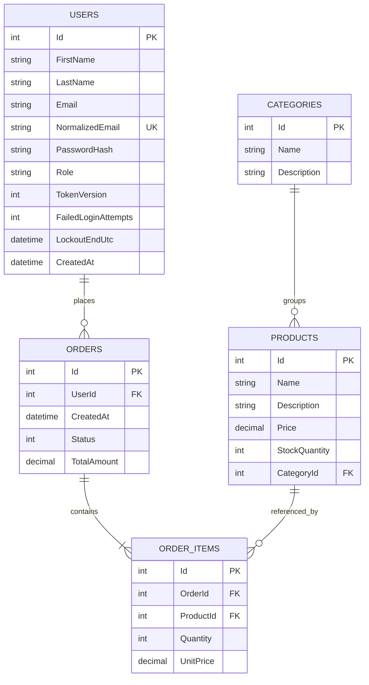
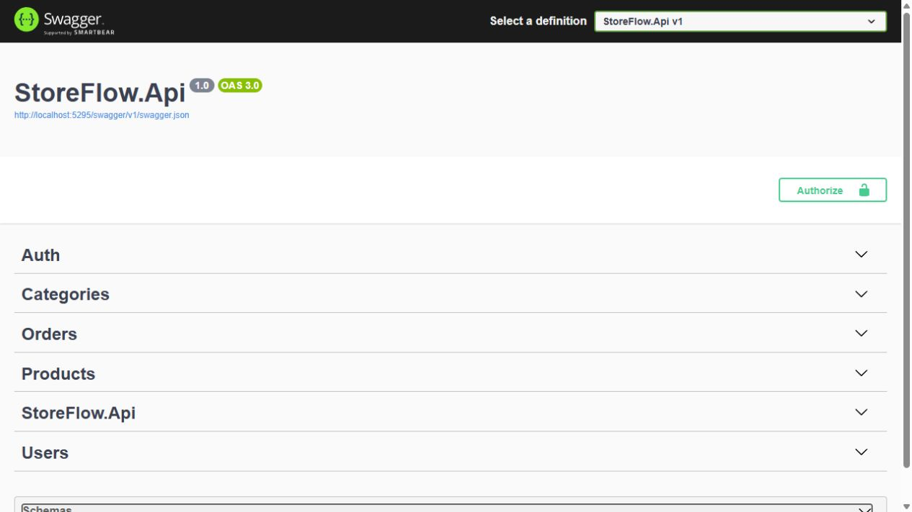
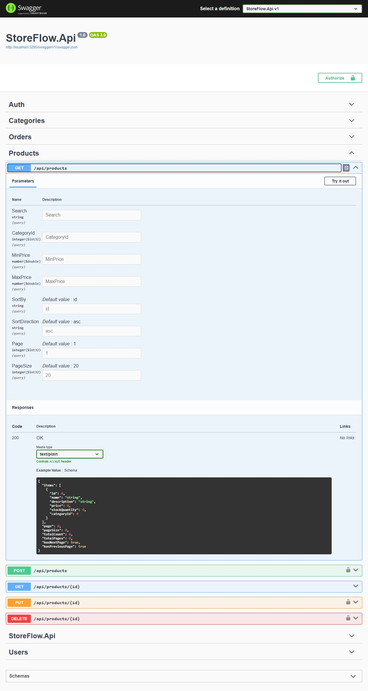

# StoreFlow

ASP.NET Core 8 Web API для каталогу товарів і замовлень із PostgreSQL та EF Core.

## Запуск

Відкрийте StoreFlow.sln у Visual Studio. Проєкт запуску — StoreFlow.Аpi.
Підключення PostgreSQL задається через ConnectionStrings:DefaultConnection.
Пароль не зберігається у файлах проєкту. Для локальної розробки один раз виконайте:

```powershell
pwsh -NoProfile -File scripts/Set-LocalDatabase.ps1
```

Скрипт приховано запитає пароль і збереже повне підключення в .NET User Secrets.
У appsettings.json залишені лише несекретні параметри.
Для іншого середовища передайте повне підключення через ConnectionStrings__DefaultConnection;
не додавайте фактичні облікові дані в Git або README.
Перед першим запуском після оновлення застосуйте міграції в Package Manager Console:

```powershell
Update-Database -Project StoreFlow.Infrastructure -StartupProject StoreFlow.Аpi
```

Альтернатива — виконати scripts/migrate-catalog.sql через PostgreSQL. Скрипт ідемпотентний і містить усі міграції.

Один раз налаштуйте локальний ключ JWT:

```powershell
pwsh -NoProfile -File scripts/Initialize-LocalSecrets.ps1
```

Ключ генерується випадково та зберігається через .NET User Secrets поза проєктом.
Скрипт зберігає вже налаштований ключ. Не додавайте його до appsettings.json або Git.
Для середовища Production передайте Jwt__Key, Jwt__Issuer та Jwt__Audience через налаштування середовища.

Запуск із термінала:

```powershell
dotnet run --project StoreFlow.Аpi --launch-profile http
```

Swagger: http://localhost:5276/swagger

## Архітектура

- Domain — сутності та статуси.
- Application — DTO, інтерфейси, бізнес-правила.
- Infrastructure — EF Core, репозиторії, транзакції та міграції.
- Api — контролери, DI, middleware помилок.
- IntegrationTests — перевірки через HTTP та PostgreSQL.
- UnitTests — xUnit v3, бізнес-правила без PostgreSQL.

## Запуск у Docker

Потрібні Docker із Linux-контейнерами, Docker Compose та PowerShell 7.
Створіть локальні випадкові секрети й запустіть стек:

```powershell
pwsh -NoProfile -File scripts/Initialize-DockerEnv.ps1
docker compose up --build -d
```

Swagger: http://localhost:8080/swagger, готовність API: http://localhost:8080/health.
Контейнери використовують окрему PostgreSQL із власним томом; локальна база на localhost:5432 не змінюється.
Сервіс migrate застосовує міграції після готовності PostgreSQL, а api запускається після успішної міграції.
API працює від непривілейованого користувача. Порт бази не публікується на хості; API доступний лише через localhost.
Це конфігурація локальної демонстрації через HTTP. Для зовнішнього розгортання потрібне налаштування HTTPS.

Створення першого адміністратора в контейнері:

```powershell
$env:BootstrapAdmin__Email = Read-Host 'Email адміністратора'
$securePassword = Read-Host 'Пароль від 12 символів' -AsSecureString
$env:BootstrapAdmin__Password = [Net.NetworkCredential]::new('', $securePassword).Password
try {
    docker compose run --rm -e BootstrapAdmin__Email -e BootstrapAdmin__Password api --bootstrap-admin
}
finally {
    Remove-Item Env:\BootstrapAdmin__Email, Env:\BootstrapAdmin__Password
    $securePassword.Dispose()
}
```

Журнали: docker compose logs --tail 100. Зупинка зі збереженням бази: docker compose down.
Файл .env з фактичними секретами виключено з Git і Docker build context.
Не публікуйте вміст .env та повний вивід docker compose config.
Повторний Initialize-DockerEnv.ps1 зберігає наявні секрети.

## Користувачі та JWT

| Метод | Шлях | Доступ |
|---|---|---|
| POST | /api/auth/register | Реєстрація, лише роль Customer |
| POST | /api/auth/login | Вхід |
| POST | /api/auth/logout | Вхід виконано; відкликання всіх своїх токенів |
| GET | /api/users/me | Власний профіль |
| PUT | /api/users/me | Зміна власних імені та прізвища |
| PUT | /api/users/me/password | Зміна пароля з перевіркою поточного |
| GET | /api/users | Admin |
| GET | /api/users/{id} | Admin |
| PUT | /api/users/{id}/role | Admin |

Реєстрація:

```json
{
  "firstName": "Іван",
  "lastName": "Коваленко",
  "email": "ivan@example.com",
  "password": "Вкажіть_власний_пароль"
}
```

Для входу передайте email і password на /api/auth/login.
У відповіді будуть accessToken, expiresAtUtc та безпечний UserDto.
У Swagger натисніть Authorize і вставте accessToken.
В інших клієнтах використовуйте заголовок Authorization: Bearer <accessToken>.

Пароль має містити 12–128 символів. Паролі хешуються стандартним ASP.NET Core Identity PasswordHasher
із PBKDF2; однакові паролі мають різні солі.
Email унікальний без урахування регістру.
Після п’яти неправильних спроб вхід в обліковий запис блокується на 15 хвилин.
Реєстрація, вхід і зміна пароля мають спільний ліміт 20 запитів на хвилину з однієї IP-адреси.

Термін JWT — 15 хвилин. Сервер перевіряє підпис, issuer, audience та строк дії,
а також звіряє роль і версію токена з поточним користувачем у PostgreSQL.
Параметри перевірки відповідають [документації Microsoft](https://learn.microsoft.com/en-us/aspnet/core/security/authentication/configure-jwt-bearer-authentication?view=aspnetcore-8.0).
Вихід, зміна пароля або ролі відкликають попередні токени.
Refresh-токени не реалізовані — після завершення строку дії потрібно ввійти повторно.

### Перший адміністратор

Після збірки й застосування міграцій виконайте:

```powershell
pwsh -NoProfile -File scripts/New-Admin.ps1
```

Скрипт запитає вашу адресу й пароль, приховає введення пароля та створить першого Admin.
HTTP-ендпоінта створення адміністратора немає.
Якщо Admin уже існує, команда відмовить; наступні ролі призначаються через API.
Змінити роль останнього Admin неможливо.
Акаунтів із типовим паролем немає.

Призначення ролі:

```json
{ "role": "Manager" }
```

## Каталог

Categories і Products підтримують GET, POST, PUT, DELETE на /api/categories і /api/products.
Назва обов’язкова, пробіли по краях обрізаються; ціна додатна, залишок невід’ємний.
Товар має належати наявній категорії.
Читання доступне всім, зміни — Admin і Manager.

Категорію з товарами та товар у замовленні видалити не можна. Це захищено як сервісом, так і зовнішніми ключами PostgreSQL з RESTRICT.

### Пошук фільтри та сторінки Products

GET /api/products повертає об’єкт сторінки замість попереднього масиву:

```json
{
  "items": [],
  "page": 1,
  "pageSize": 20,
  "totalCount": 0,
  "totalPages": 0,
  "hasNextPage": false,
  "hasPreviousPage": false
}
```

| Параметр | Правило |
|---|---|
| search | Частина назви без урахування регістру; до 200 символів |
| categoryId | Фільтр за додатним id категорії |
| minPrice / maxPrice | Включні межі ціни, від 0; minPrice не більша за maxPrice |
| sortBy | id, name, price або stockQuantity; типово id |
| sortDirection | asc або desc; типово asc |
| page | Від 1; типово 1 |
| pageSize | Від 1 до 100; типово 20 |

Приклад комбінованого запиту:

```http
GET /api/products?search=книга&categoryId=1&minPrice=100&maxPrice=1000&sortBy=price&sortDirection=asc&page=1&pageSize=10
```

Фільтри можна поєднувати. Порожній search не застосовує пошук.
Символи %, _ та зворотна риска шукаються як звичайний текст.
При однаковому значенні поля сортування порядок додатково визначається id.
totalCount рахується після фільтрації та до пагінації; сторінка за межами результату містить порожній items.
Невалідні параметри повертають 400 з помилкою відповідного поля.
Підрахунок і читання сторінки виконуються в одному знімку PostgreSQL.

## Orders

| Метод | Шлях | Дія |
|---|---|---|
| GET | /api/orders | Список із позиціями |
| GET | /api/orders/{id} | Одне замовлення |
| POST | /api/orders | Створити й зарезервувати товар |
| POST | /api/orders/{id}/items | Додати товар або збільшити кількість |
| PUT | /api/orders/{id}/items/{itemId} | Змінити кількість |
| DELETE | /api/orders/{id}/items/{itemId} | Видалити позицію та повернути товар |
| PUT | /api/orders/{id}/status | Змінити статус |
| DELETE | /api/orders/{id} | Видалити Pending або Cancelled |

Створення (підставте id наявного користувача й товару):

```json
{
  "items": [
    { "productId": 1, "quantity": 2 }
  ]
}
```

Customer створює замовлення від свого імені: власника визначаємо з JWT.
Передавання userId іншого користувача повертає 403.
Admin і Manager можуть додатково передати userId наявного користувача.
Customer бачить лише власні замовлення; доступ до чужого id повертає 404.
Admin і Manager можуть працювати з усіма замовленнями.

Ціну позиції фіксуємо під час додавання. Повторне додавання того самого товару збільшує кількість зі збереженням ціни позиції.
Клієнт не передає TotalAmount або UnitPrice — сервер розраховує їх сам.
Замовлення містить 1–100 різних товарів; повтори товару в запиті створення відхиляються.

Залишок списується відразу під час створення або збільшення кількості.
Зменшення кількості, видалення позиції, скасування та видалення Pending повертають товар.
Останню позицію видалити не можна: слід скасувати або видалити нове замовлення.
Редагування позицій доступне лише в Pending.

Статуси передаються рядками:

```json
{ "status": "Processing" }
```

Переходи для Admin і Manager: Pending → Processing → Shipped → Completed.
Customer може лише скасувати власне замовлення до відправлення.
Pending і Processing можна перевести в Cancelled.
Повернення назад недоступне; повторна установка поточного статусу безпечна.
Після відправлення скасування не підтримується.

Усі зміни замовлення й залишків виконуються атомарно.
Блокування рядків замовлення та товарів захищають від надлишкового продажу та подвійного повернення залишку.

## Валідація

Використовуються DataAnnotations і власні PositivePriceAttribute та ValidEmailAttribute в Application.
API повертає єдиний формат помилок полів українською:

```json
{
  "title": "Помилка валідації.",
  "status": 400,
  "errors": {
    "price": ["Ціна має бути більшою за нуль."],
    "stockQuantity": ["Вкажіть залишок товару."]
  },
  "traceId": "..."
}
```

У запиті створення або оновлення товару обов’язкові name, price, stockQuantity та categoryId.
Ціна має бути більшою за нуль у межах типу decimal; залишок — цілим числом від 0 до int.MaxValue.
У замовленні кількість має бути цілим числом від 1 до int.MaxValue.
Порожні обов’язкові рядки та рядки лише з пробілів відхиляються.
Ідентифікатори мають бути додатними; існування категорії, товару та користувача перевіряють сервіси.

Email перевіряється при реєстрації та вході: без відображуваного імені, внутрішніх пробілів,
керівних символів і подвійних крапок, з коректними частинами адреси та доменом із крапкою.
Пробіли по краях обрізаються, регістр ігнорується при пошуку.
Це перевірка формату адреси, без перевірки існування поштової скриньки.
Дубль email повертає 409 у тому самому форматі з errors.email.
Перевірку в сервісі доповнює унікальний індекс PostgreSQL; одночасні реєстрації не створюють дублів.

## Помилки

API повертає ProblemDetails: 400 для валідації та нестачі товару, 404 для відсутнього товару або замовлення,
401 для відсутнього або недійсного токена чи невдалого входу, 403 для недостатніх прав,
409 для заборонених переходів, повторного email і конфліктів даних, 429 для ліміту запитів,
500 для неочікуваних помилок.
Внутрішні exception не потрапляють до відповіді; для 500 сервер записує помилку в журнал і повертає traceId.

## Перевірки

Unit-тести у Visual Studio доступні через Test Explorer. Окремий запуск:

```powershell
dotnet test StoreFlow.UnitTests
```

Повний локальний прогін перевіряє публічні конфігурації, збирає рішення, запускає unit-тести й інтеграційний виконавець:

```powershell
pwsh -NoProfile -File scripts/Run-IntegrationTests.ps1
```

Потрібні .NET 8 або новіший SDK, PostgreSQL та право CREATE DATABASE у користувача підключення.
Виконавець перевірок читає підключення з User Secrets або ConnectionStrings__DefaultConnection.
Тест створює окрему базу storeflow_orders_qa_..., запускає свій API на вільному порту та видаляє лише свою базу.
Основна база не використовується для тестових записів.
Перевіряються міграції на наявних даних, CRUD, валідація, статуси, точність цін, rollback,
конкурентні запити, пошук, фільтри, сортування, пагінація, безпечна відповідь 500, JWT, власники замовлень, ролі, відкликання токенів,
ліміт спроб входу та збереження останнього Admin. Журнали — StoreFlow.IntegrationTests/results.

## GitHub Actions

Workflow .github/workflows/ci.yml запускається для push у main/master, pull request та вручну.
Перший job перевіряє секрети, збирає Release, запускає xUnit та інтеграційні перевірки з тимчасовою PostgreSQL.
Другий job збирає Docker-образ, запускає Compose, перевіряє /health і Swagger та зупиняє стек.
Результати тестів зберігаються як артефакти workflow.
Пароль PostgreSQL у job tests належить лише одноразовому сервісу CI та не використовується локально.
Зелений статус можна підтвердити лише після виконання workflow в опублікованому репозиторії.

## Схема бази даних



У PostgreSQL Status зберігається як integer; у JSON передається назва статусу.
Зв’язки Products → Categories та OrderItems → Products забороняють каскадне видалення.
Таблиця __EFMigrationsHistory зберігає застосовані міграції.

## Swagger



Параметри пошуку, фільтрів і сторінок:



## Межі поточної реалізації

Не реалізовані оплата, доставка, підтвердження email, відновлення пароля, refresh-токени та строк завершення резерву товару.
Навантажувальний тест і промислове розгортання ще не виконувалися.
